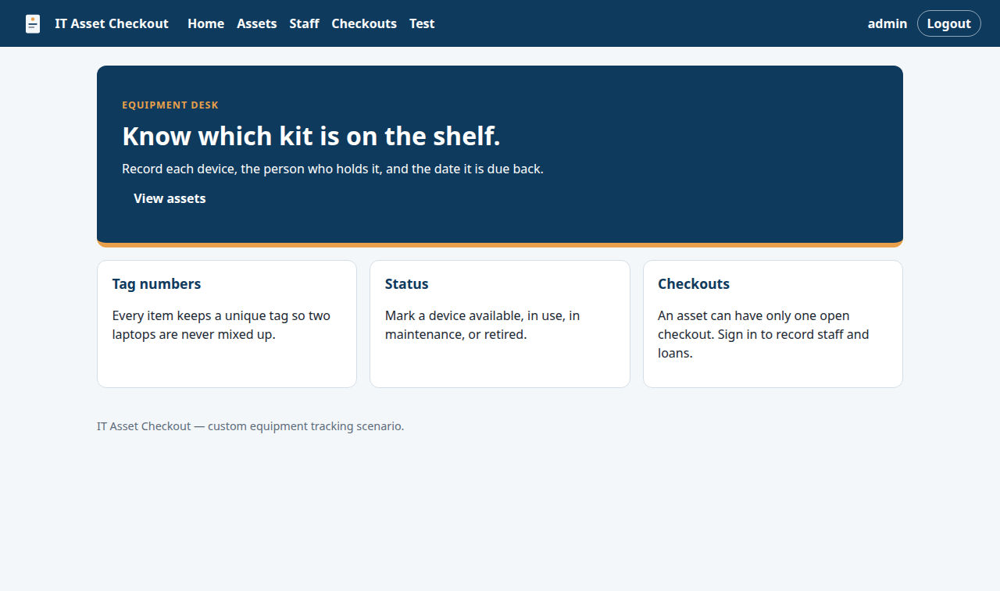
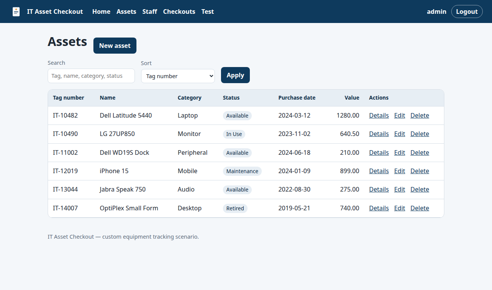
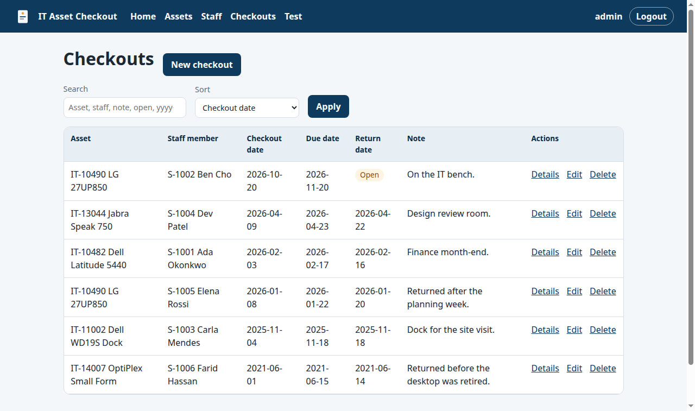
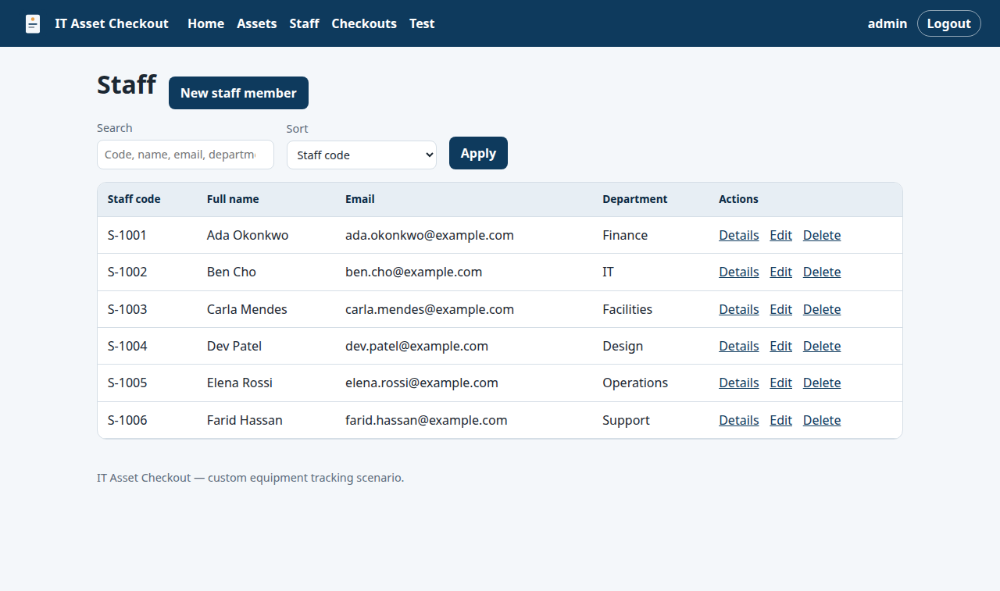
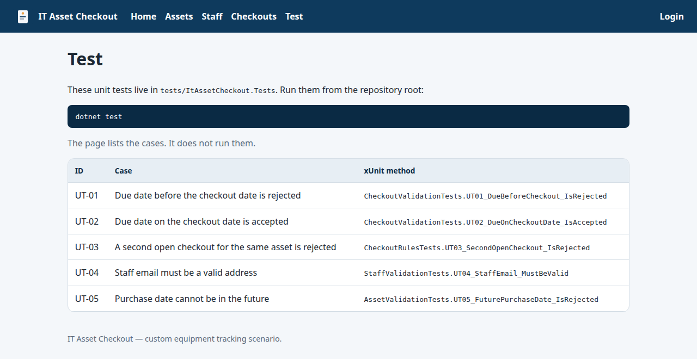
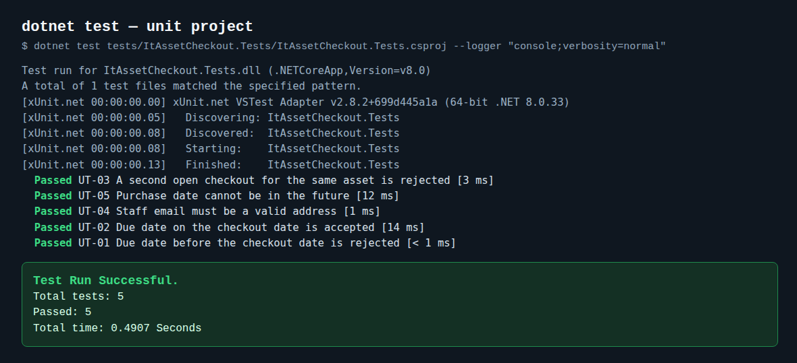
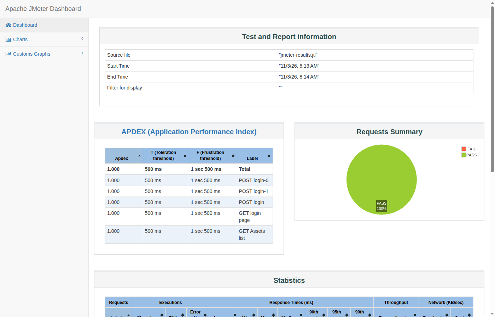

# Secure Agile Web Development Project

SD6503 Testing and Secure Coding · 2026 Final Project

The chosen business scenario is **IT Asset Checkout** (ASP.NET Core 8 + cookie Identity). It is a custom equipment-loan application, not a course sample. Staff hold the people. A Checkout links one asset to one staff member, and an asset can have only one open checkout (a row whose return date is empty). Local and development runs use SQLite so the app starts without a database server. The production and demo target is SQL Server. The provider is switchable: set `DatabaseProvider` to `SqlServer` and point `ConnectionStrings:DefaultConnection` at SQL Server. Create and edit paths enforce required fields, email format, duplicate tag numbers and staff codes, a due date on or after the checkout date, and a single open checkout per asset.

The GitHub repository is https://github.com/yq6666-66/sd6503-secure-agile-web. Solution, project, and folder names stay `ItAssetCheckout` (`ItAssetCheckout.sln`, `src/ItAssetCheckout`).

## Screenshots

Selenium UI evidence is the signed-in home, Assets, Checkouts, and Staff shots. The Test page and the unit-test pass image are the in-app catalog and a `dotnet test` run. The last image is the JMeter HTML dashboard from the recorded run.



*Signed-in home (file name `sel-01-login.png`): equipment desk, with the demo user and Logout in the header.*



*Assets list: search, sort by tag number, and the seeded equipment rows.*



*Checkouts list: one open checkout and the returned loans.*



*Staff list (SEL-04): search, sort by staff code, and the seeded people rows.*



*Public Test page at /Test: the catalog of unit cases UT-01 through UT-05.*



*Unit-test run: dotnet test on the unit project, with UT-01 through UT-05 passed.*



*JMeter dashboard from the recorded run under `docs/performance/`.*

## How this delivery maps to the assessment

The list below maps this tree to the main objectives and deliverables in the SD6503 brief. Each item points at evidence already in the repository. It does not record a mark or a lecturer sign-off.

The testing documents include an IEEE 829 test plan at `docs/testing/ieee-829-test-plan.md`.

### 1. Black-box testing

Maps to `docs/testing/black-box.md` (signed-in list pages, search, and the asset–staff relation on checkout rows).

### 2. White-box testing

Maps to `docs/testing/white-box.md` (validation messages and boundary inputs).

### 3. Grey-box testing (unit tests and the Test page)

Maps to `docs/testing/unit-tests.md` (UT-01 through UT-05), the public page `/Test`, and `dotnet test`. Screenshots: `docs/testing/screenshots/test-page.png` and `docs/testing/screenshots/unit-tests-pass.png`.

### 4. Automation testing (Selenium WebDriver)

Maps to `docs/testing/selenium.md` and the recorded run in `docs/testing/selenium-run.md`. Screenshots from that run are under `docs/testing/selenium/screenshots/`.

### 5. Static code analysis

Maps to `docs/security/security-code-scan.md`. The OWASP Top 10 map is `docs/security/owasp-top-10.md`.

### 6. Web performance and load testing (JMeter)

Evidence under `docs/performance/`: the plan `it-asset-checkout.jmx`, the write-up `results-summary.md`, the dashboard `jmeter-dashboard.png`, and the recorded `results.jtl` and `statistics.json`.

### 7. Agile (user stories, priority, sprints, Trello)

Evidence under `docs/agile/`: user stories in `user-stories.md`, MoSCoW priority in `moscow.md`, sprint notes in `sprint-1.md`, `sprint-2.md`, and `sprint-3.md` (sprint 3 remains the skeleton in that file), and the Sprint 1 burndown chart `burndown-sprint1.svg`. Trello steps are in `trello.md`. A Product Owner invite and a Moodle upload pack are human steps outside this snapshot.

### 8. Presentation

The English deck is `presentation/IT-Asset-Checkout-demo-deck.pptx`. Slide 5 embeds the main live-path demo clip (English narration, target length at most about 180 seconds). Slide 7 embeds the step-8 / Selenium path clip (English narration). Open the file in PowerPoint or a compatible viewer; the videos play from those slides. How the deck was assembled, the slide map, and the embedded media checksums are in `presentation/README.md`.

## Run

Install the .NET 8 SDK, then from the repository root:

```bash
dotnet restore
ASPNETCORE_ENVIRONMENT=Development dotnet run --project src/ItAssetCheckout
```

Open http://localhost:5080. Setting `ASPNETCORE_ENVIRONMENT=Development` keeps `Demo:SeedUser` true so the demo account can be created when `DEMO_ADMIN_PASSWORD` is set.

With the default SQLite provider, on first run the app creates `src/ItAssetCheckout/it-asset-checkout.db` and, when each table is empty, inserts six assets, six staff members, and six checkouts. One of those checkouts is open. If a SQLite database file from an earlier sample has no Staff or Checkouts table, startup recreates that file and seeds it again. Delete the file yourself when you want a clean seed.

## Demo sign-in

Demo environment only. Do not use this account in production.

Assessment sign-in uses the username and password in the local `.env` (see `.env.example` and the testing docs). Copy `.env.example` to `.env` (gitignored), set `DEMO_ADMIN_PASSWORD` locally, then export it before you run. Do not commit `.env`, and do not paste the password into this README.

```bash
set -a
source .env
set +a
ASPNETCORE_ENVIRONMENT=Development dotnet run --project src/ItAssetCheckout
```

The username defaults to `admin` when `DEMO_ADMIN_USER` is empty. The account is created only when `Demo:SeedUser` is `true` and `DEMO_ADMIN_PASSWORD` is set. `SeedUser` is `true` in `appsettings.Development.json` and `false` in `appsettings.json`. The password is not stored in appsettings.

Assets, Staff, and Checkouts require a signed-in user. Home, Login, and the Test page stay public. The header shows the username and Logout after sign-in.

Each list has a search box and a sort. Assets search tag number, name, category, or status. Staff search staff code, name, email, or department. Checkouts search asset, staff member, note, the word `open`, or a date written `yyyy-MM-dd`, and sort by checkout date, asset, staff, due date, or return date.

## Windows

`scripts/windows/` holds one-click launchers for a local demo on Windows. Each script starts in its own folder and walks up until it finds `ItAssetCheckout.sln`. Copy `.env.example` to `.env` and set `DEMO_ADMIN_PASSWORD` before the first launch. `.env` stays gitignored. The scripts load that file and do not contain a password.

Double-click a `.bat` file. It starts Windows PowerShell 5.1 (`powershell.exe`) with `-ExecutionPolicy Bypass` and the matching `.ps1`.

- `scripts/windows/Start-IT-Asset-Checkout.bat` restores the solution, starts the site at http://127.0.0.1:5080, and opens a browser. Close that window to stop the server.
- `scripts/windows/Open-Slide7-Evidence.bat` is the slide-7 live order. It checks that the site is up, runs Selenium with `RUN_SELENIUM=1`, runs the JMeter plan (20 threads, about 60 seconds), stops ItAssetCheckout host processes that lock build outputs, then runs `dotnet clean` and `dotnet build` on `src/ItAssetCheckout`. Warning SCS0018 is expected, and the build should report 0 errors. It then opens the security notes, the Trello board, the OWASP map, and the agile notes, and waits for Enter between steps. JMeter is `%JMETER_HOME%\bin\jmeter.bat` when that file exists, otherwise `C:\Tools\apache-jmeter-5.6.3\bin\jmeter.bat`. The plan receives `-JdemoPassword` from the loaded `.env`.
- `scripts/windows/Open-Test-Evidence.bat` opens the testing write-ups, Selenium screenshots, performance notes, and security notes already in the tree. It does not re-run those tools.

## Tests

```bash
dotnet test
```

That command runs the five unit cases. The Selenium cases stay skipped unless the site is already running and `RUN_SELENIUM=1` is set. The commands and the case tables are in `docs/testing/`. The Test page lists UT-01 through UT-05.

## Switch to SQL Server

1. Set `DatabaseProvider` to `SqlServer`.
2. Set `ConnectionStrings:DefaultConnection` to your SQL Server string. Start from the example in `appsettings.Development.json` under `ConnectionStrings:SqlServerExample` and replace the placeholder password locally. That placeholder is not a real secret. Do not commit a real password.
3. Run the app against an empty database. The schema is created on startup with `EnsureCreated`. If that database was created before Staff and Checkouts existed, startup drops and recreates it (`DemoSeeder` calls `EnsureDeleted` for non-SQLite providers, then `EnsureCreated` again).

## Folder layout

```
src/ItAssetCheckout/
  Controllers/    Home, Account, Assets, Staff, Checkouts, and the Test page
  Data/           EF Core context and first-run seed
  Models/         Asset, Staff, Checkout, list filters, and the login form
  Views/          Razor pages for home, login, and the three registers
  wwwroot/        Primary colour styles and the logo placeholder
  Program.cs      Host, cookie Identity, and the database provider switch
tests/ItAssetCheckout.Tests/       xUnit cases UT-01 through UT-05
tests/ItAssetCheckout.Selenium/    Browser cases, skipped unless RUN_SELENIUM=1
docs/testing/                      IEEE 829 plan and the four test write-ups
docs/security/                     Static analysis notes and the OWASP map
docs/performance/                  JMeter plan and the recorded run
docs/agile/                        Stories, MoSCoW, sprint notes, burndown, Trello checklist
scripts/windows/                   Windows one-click launchers for the local demo
presentation/                      English demo deck with embedded narration clips
presentation/IT-Asset-Checkout-demo-deck.pptx        Current demonstration PowerPoint
presentation/README.md             How the deck was built and how to open it
```

## Still later

A live Trello invite for the product owner and any Moodle-style upload pack are outside this repository snapshot. `docs/agile/trello.md` lists the human steps for the board. The demonstration deck is already in `presentation/`.
