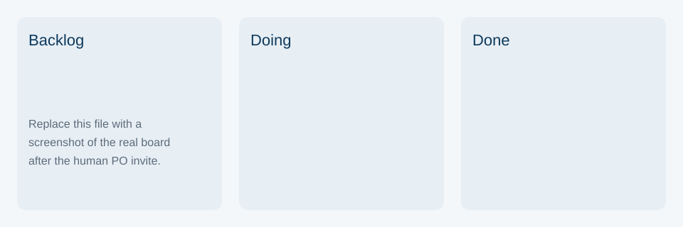

IT Asset Checkout is a custom equipment-loan scenario, not a course sample.

# Trello

This repository does not create a Trello board and does not send an invite. A person with access to the board does that.

## Columns

| Column | What belongs there |
|---|---|
| Backlog | Stories not started. Begin with US-01 through US-08 from `user-stories.md`. |
| Doing | The story currently being changed. |
| Done | Stories already in the draft build. On 2026-11-03 that is US-01 through US-08. |

## Checklist for the human invite

- [ ] Create a board named IT Asset Checkout.
- [ ] Add the three columns Backlog, Doing, and Done.
- [ ] Add one card per user story.
- [ ] Move US-01 through US-08 to Done if the draft build is the one being shown.
- [ ] Invite the product owner with the email address the team was given. Do not invent that address here.
- [ ] Export or screenshot the board.
- [ ] Replace the placeholder image below with that screenshot.

## Placeholder

The image below is not a Trello board. Replace the file `trello-board-placeholder.svg` with the real screenshot and keep this path, or change the image link to the new file.

